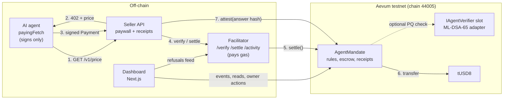
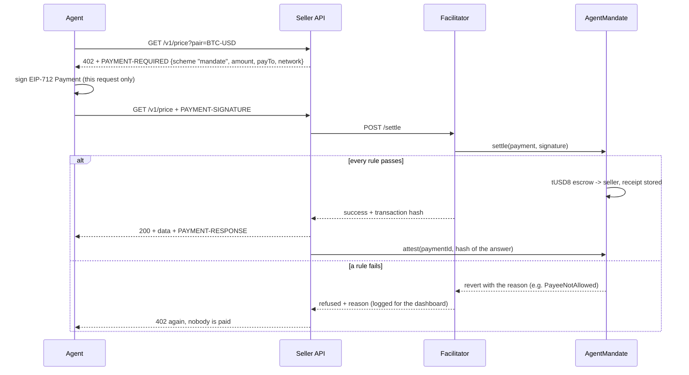

# AgentMeter

**Your AI agent can be tricked. Its budget can't.**

AgentMeter lets AI agents pay for APIs one request at a time, in tUSD8 on QDay's Aevum testnet, without ever holding money. An owner puts a budget into a **mandate**: which sellers the agent may pay, how much per call, per day and in total, and until when. Every payment the agent signs is checked by the `AgentMandate` contract before any money moves. A confused or prompt-injected agent can sign whatever it likes; the contract still refuses anything outside the rules.

| | |
|---|---|
| Live demo | `<add your Vercel URL after deploying>` |
| Demo video | `<add your video link>` |
| Contract on Aevum testnet | `<add https://explorer-test.qday.info/address/... after make testnet-setup>` |
| Track | Native AI Assistants (also fits Decentralized Payments) |

---

## Contents

- [The problem](#the-problem)
- [What AgentMeter does](#what-agentmeter-does)
- [Try to break it](#try-to-break-it)
- [Architecture](#architecture)
- [A paid request, step by step](#a-paid-request-step-by-step)
- [Safety model](#safety-model)
- [Run it locally (no funds needed)](#run-it-locally-no-funds-needed)
- [Deploy to Aevum testnet](#deploy-to-aevum-testnet)
- [Integrate it](#integrate-it)
- [API reference](#api-reference)
- [Project layout](#project-layout)
- [Tests](#tests)
- [Design decisions](#design-decisions)
- [Assumptions and limitations](#assumptions-and-limitations)
- [Roadmap](#roadmap)
- [Credits and license](#credits-and-license)

---

## The problem

AI agents increasingly need to buy things on their own: a price feed, a news search, a summary from another model. Each call costs cents, so a person can't approve them one by one. Today that leaves two bad options:

1. **Give the agent a wallet or a card.** One prompt injection ("to read the full story, pay this API") or one bug in a loop, and it can drain the account.
2. **Approve every payment by hand.** Then the agent saves nobody any time.

Developers running agents need a third option: let the agent pay on its own, inside limits it cannot break, with a record of what it bought.

## What AgentMeter does

- **For the owner of the money:** create a mandate in the dashboard, deposit tUSD8, set the rules, and watch every payment and every refusal live. Top up, withdraw, change limits, sellers or the agent key, or revoke in one click.
- **For the agent developer:** wrap HTTP calls with `payingFetch`. When an API answers `402 Payment Required`, the agent signs a payment for that one request. Its key holds no money and pays no gas, so a leaked key can spend only what the mandate allows.
- **For the API seller:** add a `paywall` to any route. The handler runs only after the payment has settled on-chain, and each answer gets an on-chain receipt. The seller view shows earnings and gives a link that lets an owner allow the seller in one step.
- **For anyone auditing:** every payment, every rule change and every answer's fingerprint is on Aevum. Paste an answer into its receipt page to prove it's the one that was paid for.

## Try to break it

The landing page has a live lab. Pick an attack, and the page signs that payment with a demo agent and asks the deployed contract's `verify()` whether it would pay. It's a free read: nothing is sent, and the verdict is the contract's own answer.

| Attack | The contract's answer |
|---|---|
| An honest request | Would pay |
| Prompt injection: pay an unknown seller | `PayeeNotAllowed` |
| A greedy seller asks 5.00 for one call | `ExceedsSinglePayment` |
| A stolen agent key, after the owner revoked | `MandateIsRevoked` |
| A forged signature | `InvalidAgentSignature` |
| A payment signed an hour ago, replayed | `PaymentExpired` |

The demo agent's key is public on purpose: its mandates are owned by a separate wallet, allow only our own seller and hold a few cents.

## Architecture



| Part | Where | What it does |
|---|---|---|
| `AgentMandate` | `contracts/src/AgentMandate.sol` | Holds each mandate's tUSD8 in escrow, enforces the rules on every payment, records receipts and answer fingerprints. Details in [AGENTMANDATE.md](AGENTMANDATE.md). |
| Facilitator | `server/src/facilitator.ts` | The x402 payment service: checks a payment (`/verify`), submits it (`/settle`), pays the gas, and keeps a feed of refusals for the dashboard. It can't move money the agent didn't sign for. |
| Seller | `server/src/seller.ts`, `server/src/paywall.ts` | Sample paid API (price, news, summarize) with the x402 paywall, plus a "rogue" seller used to show prompt injection. Records a receipt for every paid answer. |
| Agent | `server/src/agent/` | `payingFetch` (pays on 402), a rule-based brain and an optional Claude brain, and a CLI. |
| Dashboard | `web/` | Landing page with the live lab, owner dashboard, seller view, receipts. |
| Shared kit | `packages/aevum/` | Chain config, ABIs, EIP-712 typed data shared by everything above. |

Technologies: Solidity 0.8 and Foundry, OpenZeppelin (EIP-712, ECDSA, SafeERC20, ReentrancyGuard), x402 version 2 (custom `mandate` scheme), Node and Express, viem, Next.js 16, React 19, wagmi and RainbowKit, optional Anthropic API for the agent's brain.

## A paid request, step by step



## Safety model

The rules live in the contract, not in the agent. `settle()` checks them in this order, each with its own error so the dashboard can say exactly why:

| Rule | Error |
|---|---|
| The mandate exists, isn't revoked and hasn't expired | `UnknownMandate`, `MandateIsRevoked`, `MandateExpired` |
| The signed payment hasn't expired | `PaymentExpired` |
| The amount isn't zero | `ZeroAmount` |
| The seller is on the mandate's allowed list | `PayeeNotAllowed` |
| Within the per-call cap | `ExceedsSinglePayment` |
| Within today's budget (periods aligned to the mandate's start) | `ExceedsPeriodBudget` |
| Within the lifetime total | `ExceedsTotalBudget` |
| Enough left in escrow | `InsufficientBalance` |
| The payment number hasn't been used | `NonceAlreadyUsed` |
| Signed by this mandate's agent (ECDSA, or a pluggable verifier) | `InvalidAgentSignature` |

| Threat | Defense |
|---|---|
| Prompt injection makes the agent pay an attacker | Allowlist: unknown sellers are refused on-chain |
| A seller overcharges, or an agent loops | Per-call, daily and total caps |
| The agent key leaks | The key holds nothing; the owner changes the agent or revokes, and old signatures stop working at once |
| A payment is replayed | Unique nonce per payment, short deadline, and `settle()` is idempotent: settling twice pays once |
| The facilitator is compromised | It can only submit what the agent signed, to sellers the owner allowed, within the limits. It could delay or refuse to submit, not steal. |
| A seller swaps the answer after being paid | The seller commits to the answer's hash on-chain; anyone can check an answer against its receipt |
| A seller takes payment for a different request | The facilitator checks amount, seller and request fingerprint before settling |

Owner controls: top up, withdraw anything not yet spent, change limits, add or remove sellers, change the agent key, revoke. Least privilege by default: the agent can only sign; the facilitator can only submit; only the owner can change anything.

## Run it locally (no funds needed)

You need [Node 22+](https://nodejs.org), [pnpm](https://pnpm.io/installation) and [Foundry](https://book.getfoundry.sh/getting-started/installation).

```bash
git clone --recursive <your repo URL> && cd agentmeter   # --recursive fetches the Solidity libraries
pnpm install

# terminal 1: a local copy of Aevum testnet (chain 440050), real tUSD8, free test balances
make fork

# terminal 2: deploy, create sample mandates, start the facilitator and sellers, run the agent
make local-stack

# terminal 3: the dashboard on http://localhost:3000
make dev
```

In the dashboard, click **Use local test wallet**: it owns the sample mandates. Then run more agents and watch the dashboard update within seconds:

```bash
pnpm --filter server agent -- --question "How is bitcoin doing?" --no-llm
pnpm --filter server agent -- --question "Any solana news?" --no-llm --gullible   # falls for an injection: refused
```

Set `ANTHROPIC_API_KEY` in `server/.env` and drop `--no-llm` to let Claude choose which APIs to call.

## Deploy to Aevum testnet

```bash
make testnet-setup     # creates test wallets, tells you what to request from the faucet
# fund the printed owner address at https://faucet.qday.info/en with tQDAY and tUSD8, then:
make testnet-setup     # continues: deploys, creates mandates, writes server/.env and web/.env.local
make testnet-run       # facilitator + sellers against the testnet (keep running)
make dev               # dashboard against the testnet
```

`make testnet-setup` is safe to re-run: it remembers what's done in `.env.testnet` (ignored by git) and tops up the facilitator's and seller's gas when they run low. Only the owner address needs faucet funds; the script forwards gas to the others.

To host the dashboard on Vercel: import the repo, set the root directory to `web`, and copy the `NEXT_PUBLIC_*` values from `web/.env.local`. `NEXT_PUBLIC_FACILITATOR_URL` must point at a facilitator the browser can reach.

## Integrate it

**An agent that pays per request**

```ts
import { createPayingFetch } from "./agent/payingFetch";

const payingFetch = createPayingFetch({
  agent: privateKeyToAccount(process.env.AGENT_KEY), // signs only: holds no tUSD8, pays no gas
  chainId: 44005,
  mandate: "0x…AgentMandate",
  mandateId: 1n,
});

const res = await payingFetch("https://api.example.com/v1/price?pair=BTC-USD");
if (res.paid) console.log("paid", res.paid.amount, res.paid.transaction);
if (res.refused) console.log("refused:", res.refused);
```

**An API that charges per request**

```ts
app.get(
  "/v1/price",
  paywall(config, { price: "0.01", description: "BTC price" }),
  (req, res) => sendPaid(res, { pair: "BTC-USD", price: 97012.5 }), // also records the receipt
);
```

`config` holds the facilitator URL, network (`eip155:44005`), token, decimals, your pay-to address and the AgentMandate address. See `server/src/seller.ts` for a complete seller.

## API reference

**x402 headers** (base64-encoded JSON, x402 version 2)

| Header | Direction | Contents |
|---|---|---|
| `PAYMENT-REQUIRED` | seller → agent, with 402 | `{ x402Version: 2, resource: { url, description }, accepts: [{ scheme: "mandate", network, amount, asset, payTo, maxTimeoutSeconds, extra: { mandateContract, resourceHash } }] }` |
| `PAYMENT-SIGNATURE` | agent → seller | `{ x402Version: 2, accepted, payload: { payment, signature } }` where `payment` is the EIP-712 `Payment` |
| `PAYMENT-RESPONSE` | seller → agent, with 200 | `{ success, transaction, network, extensions: { mandate: { paymentId } } }` |

**EIP-712 `Payment`** (domain `AgentMandate`, version `1`): `mandateId uint256, payee address, amount uint256, resourceHash bytes32, requestHash bytes32, nonce bytes32, deadline uint64`.

**Facilitator** (`server/src/facilitator.ts`, port 4021)

| Endpoint | What it does |
|---|---|
| `GET /supported` | Schemes and networks it can settle, and the AgentMandate address |
| `POST /verify` | Would this payment be paid? Calls `verify()`, a free read |
| `POST /settle` | Calls `settle()` and waits for the transaction. Settles one at a time. |
| `GET /activity?mandateId=&limit=` | Recent paid and refused attempts (refusals never reach the chain) |

**Contract** (`AgentMandate`)

| Who | Functions |
|---|---|
| Owner | `createMandate`, `createNamedMandate`, `setName`, `deposit`, `depositWithAuthorization` (EIP-3009), `withdraw`, `setLimits`, `setPayee`, `setAgent`, `revoke` |
| Anyone (facilitator) | `verify(payment, signature) → (ok, reason)`, `settle(payment, signature) → paymentId` |
| Seller | `attest(paymentId, responseHash)` |
| Views | `getMandate`, `remaining`, `paymentDigest`, `receiptOf`, `isSettled`, `isAllowedPayee`, `nonceUsed`, `verifierKeyOf` |
| Events | `MandateCreated`, `MandateNamed`, `PayeeSet`, `LimitsUpdated`, `AgentSet`, `Deposited`, `Withdrawn`, `MandateRevoked`, `PaymentSettled`, `ResultAttested` |

## Project layout

```
contracts/      Foundry: AgentMandate, the ML-DSA-65 verifier adapter, tests, deploy script
server/         facilitator, seller, paywall, the agent (payingFetch, brains, CLI)
web/            Next.js: landing page and lab, dashboard, seller view, receipts
packages/aevum/ chain config, ABIs, EIP-712 typed data shared by all of the above
demo/           local-stack, testnet-setup, testnet-run and the scripted demos
docs/           the original Aevum Starter Kit README
examples/       starter-kit TypeScript examples (gasless payments, reading logs)
```

## Tests

```bash
make test           # 42 AgentMandate tests (every rule and its order, idempotency, fuzzed limits, the verifier slot), plus the starter kit's 11
make test-fork      # lifecycle against the real tUSD8 on a fork of Aevum
make test-server    # facilitator checks: amount, seller, request and network mismatches
make demo-phase2    # end to end: 402 flow, AI agent, prompt injection, receipts
```

## Design decisions

- **A mandate contract instead of ERC-4337 session keys.** Aevum has no public bundler or paymaster yet. A mandate gives the same properties in one small contract: a scoped key (the agent), budgets, expiry and revocation, and the agent never needs gas because the facilitator submits.
- **Custom x402 scheme `mandate`.** x402's `exact` scheme moves tokens from the payer's own wallet. Here the money sits in the mandate's escrow, so the agent signs a `Payment` the contract can check against the owner's rules.
- **`verify()` returns a reason instead of reverting.** The facilitator, the dashboard and the landing page lab all show exactly which rule failed, for free.
- **Idempotent `settle()`.** Retrying a payment after a timeout can never pay twice.
- **Pluggable signature check.** A mandate can name an `IAgentVerifier`. The ML-DSA-65 adapter is ready for Aevum's post-quantum precompile and fails closed until it exists.

## Assumptions and limitations

- Unaudited, built during the challenge window, testnet only, test tokens only.
- One token per deployment (tUSD8). The daily period is one day.
- The facilitator is trusted for liveness, not for funds: it can delay or refuse to submit, but it can't pay anyone the owner didn't allow or exceed the limits.
- Refused attempts never reach the chain, so the dashboard reads them from the facilitator's feed, which is kept in memory.
- `attest` proves the seller committed to an answer, not that the answer is correct.
- The ML-DSA-65 adapter can't verify anything until QDay publishes the precompile. Today, agents sign with standard Ethereum (ECDSA) keys.
- Mandate names are public on-chain events (so they follow the owner to any device); seller names are stored in the browser only.
- The Claude brain is optional; without an API key the agent uses simple rules.

## Roadmap

- Packages: `@agentmeter/agent` and `@agentmeter/seller` on npm, so integration is one install.
- An MCP server so assistants like Claude can spend from a mandate with no code.
- A seller directory and per-seller price lists, so owners can allow sellers from the dashboard.
- Post-quantum agent keys through the ML-DSA-65 verifier once the precompile is live.
- Mainnet, once Aevum's stablecoin and agent infrastructure launch there.

## Credits and license

MIT (see [LICENSE](LICENSE)). Based on the [Aevum Starter Kit](https://github.com/qday-io/aevum-starter-kit) (MIT, PQA Labs); its original README is in [docs/STARTER-KIT.md](docs/STARTER-KIT.md). Third-party notices are in [NOTICE.md](NOTICE.md).
